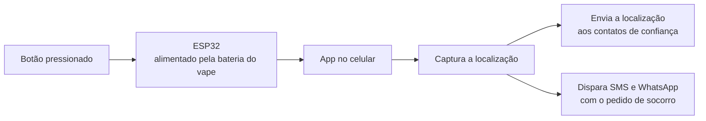

# Botão de pânico a partir de vape apreendido

Projeto de hackathon da Receita Federal. O desafio era dar uso a vapes apreendidos pela fiscalização, e a nossa resposta foi transformar a bateria recuperada em um botão de pânico discreto para mulheres, pareado com um app no celular.

Fui responsável pelo aplicativo.

## A ideia

Vape apreendido é lixo eletrônico que a Receita acumula aos milhares, e dentro dele existe uma bateria de lítio ainda boa. O botão de pânico resolvia a outra ponta do problema: um pedido de socorro precisa ser acionado sem o celular na mão, sem desbloquear a tela e sem que ninguém perceba.

A bateria recuperada alimenta um **ESP32** que fica junto com a pessoa. Pressionado o botão, o ESP32 avisa o app, e o app faz o resto.

## Fluxo do acionamento

O app mantém os contatos de confiança cadastrados antes, justamente para que o acionamento não exija nenhuma escolha no momento em que a pessoa precisa dele.

## Decisões

**O botão fica fora do celular.** Esse é o ponto do projeto. Aplicativo de emergência que depende de desbloquear a tela e achar o ícone não funciona na situação para a qual foi feito.

**Localização junto da mensagem.** Avisar que algo aconteceu sem dizer onde não ajuda quem vai socorrer, então a posição vai no mesmo envio.

**Dois canais de mensagem.** SMS e WhatsApp saem juntos porque um deles pode falhar: WhatsApp precisa de internet, SMS não; SMS depende de sinal de operadora, WhatsApp funciona no Wi-Fi.

## Stack

Flutter (Dart) · ESP32 · bateria recuperada de vape apreendido

## Equipe

Projeto desenvolvido em equipe durante o hackathon. Minha parte foi a criação do aplicativo.

---

Joyce Gomes de Queiroz — [LinkedIn](https://linkedin.com/in/--joycequeiroz)
